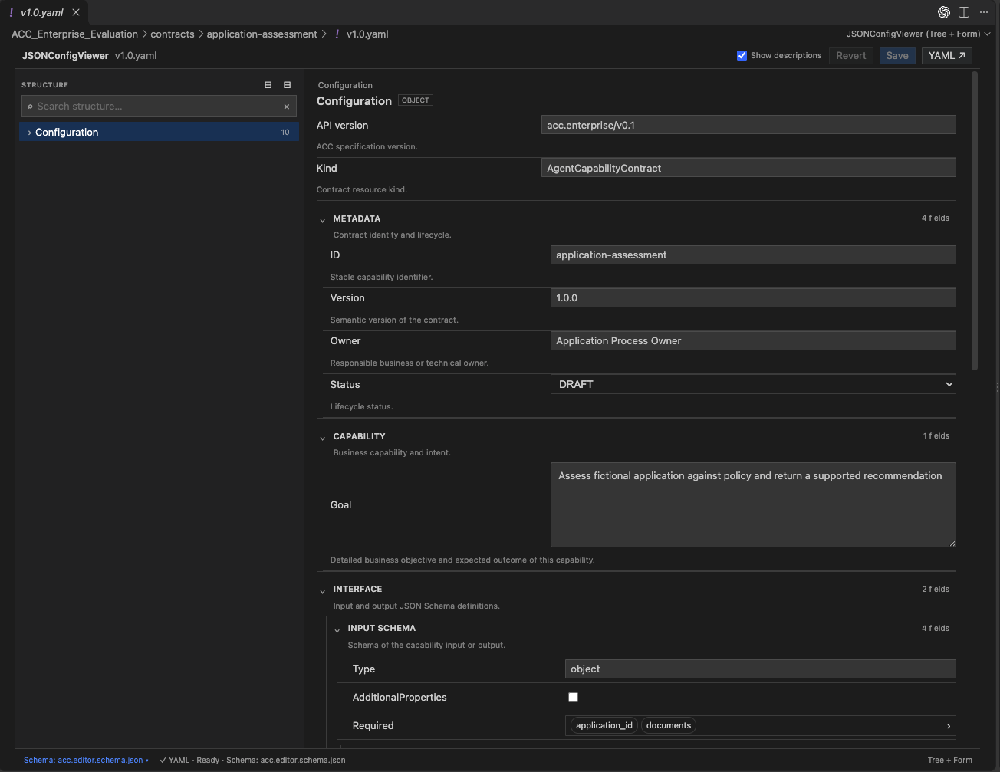

# JSONConfigViewer

**A visual YAML and JSON editor for Visual Studio Code and compatible editors.**

JSONConfigViewer lets you inspect and edit configuration files through a **structure tree and a form**, rather than manually navigating deeply nested YAML or JSON. It is particularly useful for configuration files, application settings, and structured documents described by a JSON Schema.

The original file remains a normal `.yaml`, `.yml`, or `.json` file. You can switch back to the text editor whenever you need direct source-level control.

## Screenshot



## What can it do?

- **Tree + form interface** — browse nested objects and arrays on the left, edit their values in a form on the right.
- **Structure navigation** — search for fields, expand and collapse branches, and navigate large configurations.
- **Edit common data types** — change strings, numbers, booleans, nested objects and array values using appropriate controls.
- **Inline list editing** — edit scalar array elements directly, and add or remove list items.
- **JSON Schema-aware forms** — automatically discover a local schema or choose one manually using the **Schema** control in the status bar.
- **Helpful field metadata** — use schema titles, descriptions, enumerated values and numeric constraints to present more meaningful form controls.
- **Multiline fields** — display long text as a `textarea`, including explicit `x-ui.widget: textarea` configuration and optional row count.
- **Contextual descriptions** — display descriptions from JSON Schema and YAML comments, with a **Show descriptions** toggle.
- **Editor integration** — use the editor theme and built-in **Save** and **Revert** actions.

### JSON Schema UI hints

A schema can describe how a field should appear in the form:

```json
{
  "type": "string",
  "description": "Describe the purpose of this configuration.",
  "x-ui": {
    "widget": "textarea",
    "rows": 5,
    "placeholder": "Enter a detailed description..."
  }
}
```

## Getting started

1. Open a `.yaml`, `.yml`, or `.json` file in VS Code.
2. If the visual editor does not open automatically, select **Reopen Editor With… → JSONConfigViewer (Tree + Form)**.
3. Explore the document using the structure tree and edit fields in the form.
4. To enable schema-aware fields, place a matching `.schema.json` file alongside your configuration or select one using the **Schema** control in the bottom-left status bar.
5. Save your changes using **Save**.

To try the bundled example, run **JSONConfigViewer: Open Sample YAML** from the Command Palette. The example files are `samples/balanced.yaml` and `samples/balanced.schema.json`.

## Scope and limitations

JSONConfigViewer is a **visual configuration editor**, not a full JSON Schema validation engine. Schema constraints inform form controls but do not guarantee complete validation. Advanced YAML constructs and exact source formatting may require the native text editor. Remote HTTP/HTTPS schemas are not fetched automatically.

## Development

```bash
npm install
npm test
npx @vscode/vsce package
```

## Project links

- [Source code](https://github.com/wallypi/JSONConfigViewer)
- [Report an issue](https://github.com/wallypi/JSONConfigViewer/issues)
- [Documentation](documentation.md)

## Support the project

<a href="https://www.buymeacoffee.com/wally_p"></a>

Support is optional. JSONConfigViewer is free and open source under the [Apache License 2.0](LICENSE).
